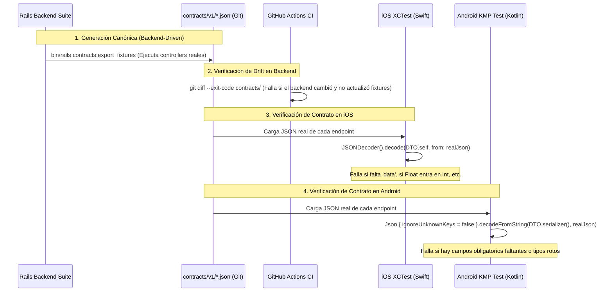

# Auditoría de Desincronización de Contratos API v1 (Backend vs Clientes) y Propuesta de Prevención Continua

**Fecha:** 2026-10-19  
**Rama:** `chore/api-contract-drift-analysis`  
**Estado:** Informe técnico completo y propuesta de arquitectura  

---

## 1. Resumen Ejecutivo

En las últimas semanas, tres incidentes independientes de producción (#542, #556, #552) revelaron un problema sistémico en la plataforma: **el backend emite una forma de datos y los clientes móviles (iOS SwiftUI y Android KMP/Compose) esperan otra, sin que la suite de integración ni CI lo detecten**. 

La causa raíz es estructural: **los tests unitarios actuales de los clientes utilizan un patrón de mock simétrico**. En estos tests, el cliente construye su propio DTO en memoria, lo codifica con `JSONEncoder`/`kotlinx.serialization`, intercepta la red con un mock y decodifica el payload generado por sí mismo. Ese test verifica que el DTO es simétrico consigo mismo, pero es completamente ciego a la forma real que emiten los controladores y vistas Jbuilder de Rails.

Esta auditoría realizó una medición exhaustiva del 100% de la superficie de la API v1 (149 rutas, 37 controladores, 127 structs en iOS y 168 data classes en Kotlin) comparada contra las respuestas reales de Rails.

### Hallazgos Principales (Medidos, no estimados)
1. **P0 Crítico (10 endpoints rotos en producción en iOS):**  
   Los módulos de **Ventas (Sales)** y **Órdenes de Compra (Purchase Orders)** en iOS carecen de wrapper de respuesta (`SaleResponseDto` / `PurchaseOrderResponseDto`). El backend emite `{ "data": { ... } }`, pero iOS intenta decodificar `SaleDto` y `PurchaseOrderDto` directamente en la raíz. **Cualquier intento de ver el detalle, crear, editar, completar, recibir o cancelar una venta o una orden de compra en la app de iOS falla inmediatamente con `DecodingError.keyNotFound("id")`**. En Android KMP, estos módulos sí cuentan con el wrapper y funcionan correctamente.
2. **P1 Alto (Fallo por tipo incompatible o nulos según datos en base de datos):**  
   - En **iOS Metas (Goals)**: El backend calcula `months_remaining` como `(days / 30.0)` devolviendo un `Float` (ej. `4.3333`). iOS lo declaró como `let monthsRemaining: Int?`. Cualquier meta cuya fecha límite no sea un múltiplo exacto de 30 días bloquea la pantalla de Metas con `DecodingError.typeMismatch`. Asimismo, `pace` es numérico en Rails y en iOS se declaró `String?` sin decorador `@AnyStringAmount`.
   - En **Android KMP Promesas (GoalPledges)**: `GoalPledgeDto.kt` declaró `val amount: Double` sin `FlexibleDoubleSerializer`, y `account_name` y `expires_at` como `String` no nulos sin valor por defecto. Si una promesa tiene cuenta nula o el decimal se serializa como string, Android crashea con `SerializationException`.
3. **P2 Medio (Divergencia latente sin invocación activa en UI):**  
   `MoneyDto` en Android KMP `BalanceSheetDto.kt` declara `amount: String?` y `cents: Long?`. El backend emite `amount` numérico y nunca emite `cents`. Actualmente no crashea en Android porque la pantalla principal usa `fetchDashboard()` en lugar de `fetchBalanceSheet()`.
4. **Superficie de OpenAPI desactualizada:**  
   **13 de los 37 controladores de la API v1 (35.1%) no tienen specs rswag en `spec/requests/api/v1/`**, lo que significa que `docs/api/openapi.yaml` carece de los contratos de todos los módulos nuevos (Ventas, Órdenes de Compra, Vehículos, Combustible, Promesas, etc.).

---

## 2. Diagnóstico del Estado Actual: Medición Exacta de Desajustes

La medición fue ejecutada mediante análisis estático de código, inspección del router de Rails y verificación con tests de integración de ActionDispatch.

### Métricas Globales del Sistema

| Dimensión | Medición Backend (Rails) | Cliente iOS (SwiftUI) | Cliente Android (KMP) |
| :--- | :---: | :---: | :---: |
| **Controladores API v1** | 37 activos (+ 1 base, 1 test) | N/A | N/A |
| **Rutas API v1 (`Api::V1`)** | 149 rutas | 81 métodos API consumidos | 82 métodos API consumidos |
| **Vistas Jbuilder** | 31 templates / partials | N/A | N/A |
| **DTOs / Modelos de red** | N/A | 127 structs `Codable` | 168 data classes `@Serializable` |
| **Controladores con specs OpenAPI** | 24 (64.9%) | N/A | N/A |
| **Controladores SIN specs OpenAPI** | 13 (35.1%) | N/A | N/A |

### Conteo Consolidado de Desajustes

| Severidad | Descripción del Desajuste | Endpoints Afectados | Cliente Afectado | Impacto en Usuario |
| :--- | :--- | :---: | :---: | :--- |
| **P0** | Ausencia de wrapper `data` en Show/Mutaciones de Ventas | 5 endpoints | iOS | Bloqueo total al abrir, crear o editar ventas |
| **P0** | Ausencia de wrapper `data` en Show/Mutaciones de POs | 5 endpoints | iOS | Bloqueo total al abrir, crear o editar pedidos |
| **P1** | Tipo incompatible `Float` vs `Int?` en `months_remaining` y `pace` | 2 endpoints | iOS | Pantalla de Metas inaccesible ante fechas no múltiplos de 30 |
| **P1** | Tipos estrictos sin fallback y nulos en `GoalPledgeDto` | 2 endpoints | Android KMP | Error al cargar promesas si cuenta es nula o monto es string |
| **P2** | `MoneyDto` esperando `amount` string en `BalanceSheet` | 1 endpoint | Android KMP | Latente (no invocado en UI actual de Android) |
| **P3** | Inconsistencia en paginación de `family_exports` (`page` en `meta`) | 1 endpoint | Ambos | Tech debt (manejado ad-hoc en KMP) |
| **P3** | 13 controladores sin especificación OpenAPI en rswag | 13 controladores | Global | OpenAPI desfasado como fuente de verdad |

---

## 3. Mapeo de Envelopes por Endpoint

Existe una divergencia estructural conocida en la arquitectura del backend: **13 controladores de colección utilizan el patrón `{ "data": [...], "meta": {...} }` y 10 controladores utilizan el patrón `{ "<recurso>": [...], "pagination": {...} }`**.

Una regla arquitectónica crítica descubierta en esta auditoría es que **el envelope de colección determina la forma de los endpoints individuales (`show`, `create`, `update`, acciones)**:
- Los recursos bajo `data`/`meta` devuelven sus recursos individuales envueltos en `{ "data": { ... } }`.
- Los recursos bajo `<recurso>`/`pagination` devuelven sus recursos individuales planos en la raíz (`{ "id": ..., ... }`).

### Tabla Exhaustiva de Envelopes por Recurso

| Recurso / Controlador | Envelope Colección (`index`) | Envelope Individual (`show`, `create`, `update`) | Consumo iOS | Consumo Android KMP |
| :--- | :--- | :--- | :--- | :--- |
| **`accounts`** | `accounts` + `pagination` | Raíz `{ id, name, ... }` | Correcto (`AccountsResponse`) | Correcto (`AccountsResponse`) |
| **`categories`** | `categories` + `pagination` | Raíz `{ id, name, ... }` | Correcto (`CategoriesResponse`) | Correcto (`CategoriesResponse`) |
| **`chats`** | `chats` + `pagination` | Raíz con `messages` paginados | Correcto | Correcto |
| **`holdings`** | `holdings` + `pagination` | Raíz `{ id, ... }` | No consumido | Correcto |
| **`recurring_transactions`**| `recurring_transactions` + `pagination` | Raíz `{ id, ... }` | No consumido | Correcto |
| **`securities`** | `securities` + `pagination` | Raíz `{ id, ... }` | No consumido | Correcto |
| **`security_prices`** | `security_prices` + `pagination` | Raíz `{ id, ... }` | No consumido | Correcto |
| **`trades`** | `trades` + `pagination` | Raíz `{ id, ... }` | No consumido | Correcto |
| **`transactions`** | `transactions` + `pagination` | Raíz `{ id, ... }` | Correcto (`TransactionDetailDto`) | Correcto (`TransactionDetailDto`) |
| **`valuations`** | `valuations` + `pagination` | Raíz `{ id, ... }` | No consumido | Correcto |
| **`budgets`** | `data` + `meta` | `{ data: { ... } }` | Correcto (`BudgetsResponseDto`) | Correcto (`BudgetsEnvelope`) |
| **`budget_categories`** | `data` | `{ data: { ... } }` | Correcto (`BudgetCategoryResponseDto`)| Correcto |
| **`fleet_vehicles`** | `data` + `meta` | `{ data: { ... } }` | Correcto (`FleetVehicleEnvelope`) | Correcto (`FleetVehicleEnvelope`) |
| **`fuel_logs`** | `data` + `meta` | `{ data: { ... } }` | Correcto (`FuelLogEnvelope`) | Correcto (`FuelLogEnvelope`) |
| **`goals`** | `data` + `meta` | `{ data: { ... } }` | Correcto (`GoalSingleResponse`) | Correcto (`GoalEnvelope`) |
| **`goal_pledges`** | `data` + `meta` | `{ data: { ... } }` | Correcto (`GoalPledgeSingleResponse`)| Correcto (`GoalPledgeEnvelope`) |
| **`imports`** | `data` + `meta` | `{ data: { ... } }` | Correcto (`ImportResponseDto`) | Correcto (`ImportResponseDto`) |
| **`products`** | `data` + `meta` | `{ data: { ... } }` | Correcto (`ProductResponseDto`) | Correcto (`ProductResponseDto`) |
| **`purchase_orders`** | `data` + `meta` | `{ data: { ... } }` | **ROTO: Espera raíz `PurchaseOrderDto`** | Correcto (`PurchaseOrderResponseDto`) |
| **`receivables`** | `data` + `meta` | `{ data: { ... } }` | Correcto (`ReceivableResponse`) | Correcto (`ReceivableEnvelope`) |
| **`rule_runs`** | `data` + `meta` | `{ data: { ... } }` | Correcto | Correcto |
| **`rules`** | `data` + `meta` | `{ data: { ... } }` | Correcto (`RuleResponseDto`) | Correcto (`RuleResponseDto`) |
| **`sales`** | `data` + `meta` | `{ data: { ... } }` | **ROTO: Espera raíz `SaleDto`** | Correcto (`SaleResponseDto`) |
| **`family_exports`** | `data` + `meta` (con `page`) | `{ data: { ... } }` | No consumido | Correcto (`FamilyExportResponseDto`) |
| **`merchants`** | Array plano `[ {...} ]` | N/A | Correcto | Correcto |
| **`tags`** | Array plano `[ {...} ]` | N/A | Correcto | Correcto |
| **`balance_sheet`** | Objeto plano raíz | `{ currency, net_worth, ... }` | Correcto (`BalanceSheetResponse`) | Incompatible en `MoneyDto` |
| **`dashboard`** | Objeto plano raíz | `{ greeting_name, currency, ... }`| No consumido | Correcto (`DashboardDto`) |
| **`family_settings`** | Objeto plano raíz | `{ id, name, currency, ... }` | Correcto (`FamilySettingsDto`) | Correcto (`FamilySettingsDto`) |
| **`reports/summary`** | Objeto plano raíz | `{ period, income, ... }` | Correcto (`ReportsSummaryDto`) | Correcto (`ReportsSummaryDto`) |
| **`sync`** | Objeto plano raíz | `{ id, status, ... }` | Correcto | Correcto |
| **`transfers`** | Objeto plano raíz | `{ id, status, ... }` | Correcto | Correcto |
| **`usage`** | Objeto plano raíz | `{ authentication_method, ... }` | Correcto (`UsageDto`) | Correcto |

---

## 4. Detalle y Clasificación de Desajustes

### 4.1. P0 Crítico: Endpoints de Ventas en iOS (5 endpoints rotos)
- **Código afectado:** `native/financespy-ios/FinancePY/Network/FinancePyApi+Sales.swift:78-107`
- **Métodos:**
  - `fetchSale(id: String) async throws -> SaleDto`
  - `createSale(payload: SaleDataPayload) async throws -> SaleDto`
  - `updateSale(id: String, payload: SaleDataPayload) async throws -> SaleDto`
  - `completeSale(id: String) async throws -> SaleDto`
  - `cancelSale(id: String) async throws -> SaleDto`
- **Backend:** `app/views/api/v1/sales/show.json.jbuilder` emite:
  ```ruby
  json.data do
    json.partial! "sale", sale: @sale
  end
  ```
- **Error:** Todos estos métodos hacen `let response: SaleDto = try await ApiClient.shared.request(...)`. Al recibir `{ "data": { "id": "..." } }`, el decodificador de Swift busca la clave `"id"` en el objeto raíz, no la encuentra y lanza:
  `Swift.DecodingError.keyNotFound(CodingKeys(stringValue: "id", intValue: nil), ...)`
- **Impacto visible:** Al pulsar sobre una venta en `SalesListView` para abrir `SaleDetailView`, la vista muestra un banner de error permanente. Las acciones de cobrar, completar, editar y crear ventas fallan.

### 4.2. P0 Crítico: Endpoints de Órdenes de Compra en iOS (5 endpoints rotos)
- **Código afectado:** `native/financespy-ios/FinancePY/Network/FinancePyApi+PurchaseOrders.swift:74-103`
- **Métodos:**
  - `fetchPurchaseOrder(id: String) async throws -> PurchaseOrderDto`
  - `createPurchaseOrder(payload: PurchaseOrderDataPayload) async throws -> PurchaseOrderDto`
  - `updatePurchaseOrder(id: String, payload: PurchaseOrderDataPayload) async throws -> PurchaseOrderDto`
  - `receivePurchaseOrder(id: String) async throws -> PurchaseOrderDto`
  - `cancelPurchaseOrder(id: String) async throws -> PurchaseOrderDto`
- **Backend:** `app/views/api/v1/purchase_orders/show.json.jbuilder` emite `{ "data": { ... } }`.
- **Error:** Idéntico a Ventas. `PurchaseOrdersResponseDto` (para `index`) fue creado, pero se omitió `PurchaseOrderResponseDto` (para `show`/acciones) y se decodifica `PurchaseOrderDto` directo en la raíz.
- **Impacto visible:** `PurchaseOrderDetailView` y creación de órdenes de compra quedan inoperables en iOS.

### 4.3. P1 Alto: `months_remaining` y `pace` en Metas en iOS
- **Código afectado:** `native/financespy-ios/FinancePY/Network/FinancePyApi+Goals.swift:21-23`
- **Backend:** `app/models/goal.rb:182`:
  ```ruby
  def months_remaining
    return nil unless target_date
    days = (target_date - Date.current).to_i
    [ (days / 30.0), 0.0 ].max
  end
  ```
- **Discrepancia:** Rails retorna un `Float` (`days / 30.0`), por ejemplo `3.4333`. iOS declara `let monthsRemaining: Int?`. Swift rechaza convertir un número de punto flotante a entero durante el decode de `Int.self`. Asimismo, `goal.pace` retorna un número (`Float`/`BigDecimal`), mientras que iOS lo declaró `let pace: String?` sin `@AnyStringAmount`.
- **Impacto visible:** Si el usuario tiene una meta activa cuya fecha objetivo no cae exactamente en un múltiplo entero de 30 días, `fetchGoals()` en iOS falla con `DecodingError.typeMismatch` y `GoalsListView` muestra un error general en lugar de la lista de metas.

### 4.4. P1 Alto: Fragilidad de deserialización en Android KMP `GoalPledgeDto`
- **Código afectado:** `native/financespy-kmp/shared/src/commonMain/kotlin/py/com/cdco/financespy/api/dto/GoalPledgeDto.kt:6-17`
- **Backend:** `app/views/api/v1/goal_pledges/_goal_pledge.json.jbuilder`:
  - `amount` proviene de una columna `numeric(19,4)` de PostgreSQL.
  - `account_name` es `pledge.account&.name` (retorna `null` si la cuenta fue desasociada o eliminada).
  - `expires_at` es nullable en modelos no validados.
- **Discrepancia:** KMP declaró `val amount: Double` sin `FlexibleDoubleSerializer`, y `val account_name: String` y `val expires_at: String` como no nulos sin valor por defecto.
- **Impacto visible:** Si la API devuelve un valor decimal serializado como string o un valor nulo en `account_name`, `kotlinx.serialization` arroja `SerializationException` al abrir promesas de ahorro en Android.

### 4.5. P2 Medio: `MoneyDto` en BalanceSheet en Android KMP
- **Código afectado:** `native/financespy-kmp/shared/src/commonMain/kotlin/py/com/cdco/financespy/api/dto/BalanceSheetDto.kt:14`
- **Backend:** `Money#as_json` (`lib/money.rb:71`):
  ```ruby
  def as_json
    { amount: amount.round(currency.default_precision), currency: currency.iso_code, formatted: format }.as_json
  end
  ```
- **Discrepancia:** KMP declara `data class MoneyDto(val cents: Long? = null, val amount: String? = null, val currency: String? = null)`. El backend emite `amount` como número flotante/decimal y no emite `cents`.
- **Impacto:** Latente. En la versión actual de Android, la pantalla Dashboard consume `fetchDashboard()` y no `fetchBalanceSheet()`. Si una futura funcionalidad o refactor llama a `fetchBalanceSheet()`, fallará inmediatamente.

### 4.6. P3 Deuda Técnica: Falta de Cobertura OpenAPI (35.1% de la API sin specs)
- **Controladores faltantes:** `sales`, `purchase_orders`, `products`, `fleet_vehicles`, `fuel_logs`, `goal_pledges`, `budget_categories`, `dashboard`, `messages`, `reports`, `sync`, `transfers`, `usage`.
- **Consecuencia:** La regla del repositorio exige specs rswag para documentar la API, pero los desarrolladores crearon los controladores más nuevos sin agregar los specs correspondientes. Esto explica directamente por qué los clientes móviles no tenían una especificación confiable contra la cual implementar sus DTOs.

---

## 5. Análisis de Causa Raíz

¿Por qué estos 10 endpoints rotos y 3 incompatibilidades de tipo pasaron inadvertidos por las suites de pruebas y CI?

```mermaid
flowchart TD
    subgraph TestingActual["Patrón Actual de Tests en Clientes (Falsa Simetría)"]
        A["Construir DTO en memoria (ej: SaleDto)"] --> B["Serializar con JSONEncoder / kotlinx"]
        B --> C["Mock de Red devuelve ese JSON generado"]
        C --> D["Decodificar JSON con DTO"]
        D --> E["XCTAssert / assertEquals PASA EN VERDE ✅"]
    end

    subgraph ProduccionReal["Comportamiento Real en Producción"]
        F["Backend Rails + Jbuilder"] --> G["Payload Real: { 'data': { ... } }"]
        G --> H["Cliente Móvil: Decodifica SaleDto"]
        H --> I["DecodingError.keyNotFound / typeMismatch ❌ CRASH"]
    end
```



1. **La trampa del test simétrico:**  
   En `FinancePyApiSalesTests.swift` y `FinancePyApiPurchaseOrdersTests.swift`, el desarrollador escribió:
   ```swift
   let sale = SaleDto(...)
   let responseDto = SalesResponseDto(data: [sale])
   let data = try JSONEncoder().encode(responseDto)
   MockURLProtocol.requestHandler = { _ in (response, data) }
   let result = try await FinancePyApi.shared.fetchSales()
   XCTAssertEqual(result.count, 1)
   ```
   El test prueba la serialización de Swift contra Swift. Ni siquiera existía un test para `fetchSale(id:)`, pero si hubiera existido bajo ese patrón, habría codificado un `SaleDto` suelto y habría pasado en verde igual.
2. **Asimetría de tolerancia al error:**  
   - En **Android KMP**: El cliente usa `ignoreUnknownKeys = true` y define valores por defecto como `emptyList()` en muchas listas. Si el backend cambia el nombre de una clave o cambia el envelope, Android no lanza error: **produce una lista vacía en silencio**. La UI muestra "Sin ventas" o "Sin transacciones" y ningún log reporta fallo.
   - En **iOS SwiftUI**: Swift es estricto por defecto. Cualquier clave no encontrada en un tipo no opcional, o cualquier discrepancia de `Int` vs `Double`, detiene el flujo de ejecución arrojando una excepción.

---

## 6. Evaluación de Alternativas Arquitectónicas

Evaluamos cuatro mecanismos posibles para resolver este problema de fondo en CI:

| Criterio | Opción A: Golden Fixtures desde Backend Real | Opción B: Consumer-Driven Contracts (Pact) | Opción C: Generación de DTOs con OpenAPI Codegen | Opción D: CI Schema AST Linter / Diff |
| :--- | :---: | :---: | :---: | :---: |
| **Fidelidad al backend real** | **100% (Ejecuta Rails real)** | Media (Mocks de interacción) | Baja (Depende de rswag manual) | Media (Análisis estático frágil) |
| **Detección de envelopes** | **Inmediata y certera** | Requiere configuración | Solo si OpenAPI está 100% al día | Propensa a falsos positivos |
| **Detección de tipos reales** | **Exacta (`Float`, `String`, etc.)** | Alta | Teórica (según schema) | Limitada |
| **Complejidad de adopción** | **Baja (Aprovecha Minitest)** | Muy alta (Broker Pact) | Media-Alta (Rompe DTOs custom) | Media |
| **Impacto en CI** | **Rápido (pocos segundos)** | Lento (I/O externo) | Rápido | Rápido |
| **Mantenibilidad** | **Alta (Un commit unificado)** | Baja (Mucha sobrecarga) | Media | Baja (Metaprogramación Rails) |

### Análisis de las Opciones No Recomendadas:
- **Opción B (Pact):** Excesiva para un monorepo / repositorio único. Requiere montar infraestructura de broker y agrega fricción considerable al desarrollo diario de features simples.
- **Opción C (OpenAPI Codegen):** Hoy es **inviable como primera línea de defensa** porque el 35.1% de la API no está en OpenAPI. Además, los clientes móviles poseen decoradores y lógica de UI fuertemente acoplada a sus DTOs (ej. `@AnyStringAmount`, `Identifiable`, conformidades de Compose). Generar código reemplazaría código funcionando y requeriría una reescritura masiva.
- **Opción D (AST Linter):** Rails y Jbuilder utilizan metaprogramación dinámica (`json.partial!`, `json.extract!`, herencia de layouts). Analizar estáticamente el AST de Jbuilder conduce a constantes falsos positivos y falsos negativos.

---

## 7. Propuesta Recomendada: Mecanismo "Golden Fixtures Contract CI"

Proponemos la **Opción A (Golden Fixtures generadas por el Backend)** como la fuente única de verdad canónica.

### Arquitectura del Mecanismo



### Componentes de la Solución:

1. **Generador Canónico en Backend (`test/contracts/api_v1_contract_export_test.rb`):**
   - Una suite de Minitest que utiliza la infraestructura existente de `ActionDispatch::IntegrationTest` y las fixtures de test (`users(:family_admin)`, `accounts(:depository)`, etc.).
   - Itera por cada controlador y acción de la API v1.
   - Guarda la respuesta JSON real en el repositorio bajo `test/fixtures/contracts/v1/{recurso}_{accion}.json`.
2. **Guardián en CI para Backend:**
   - En el workflow de CI de Rails (`.github/workflows/ci.yml`), un paso ejecuta:
     ```bash
     bin/rails test test/contracts/api_v1_contract_export_test.rb
     git diff --exit-code test/fixtures/contracts/v1/
     ```
   - Si un desarrollador modifica un Jbuilder o un serializador en el backend y la forma de la respuesta cambia, CI **exige** que el fixture de contrato se actualice en el mismo commit.
3. **Tests de Decodificación de Contrato en iOS (`FinancePYTests/Contracts/`):**
   - Un suite `ApiContractDecodingTests.swift` que lee directamente los archivos JSON de `test/fixtures/contracts/v1/`.
   - Para cada endpoint, ejecuta:
     ```swift
     let data = try loadContractFixture("sales_show.json")
     XCTAssertNoThrow(try JSONDecoder().decode(SaleResponseDto.self, from: data))
     ```
   - **Resultado:** El bug de `SaleDto` o de `monthsRemaining: Int?` **hace fallar el build de iOS en CI inmediatamente**, antes de fusionar cualquier PR.
4. **Tests de Decodificación de Contrato en Android (`sharedTest/contracts/`):**
   - Un suite `ApiContractDecodingTest.kt` en `native/financespy-kmp/shared/src/commonTest/`:
     ```kotlin
     val jsonString = loadContractFixture("goal_pledges_index.json")
     assertDoesNotThrow {
         jsonStrict.decodeFromString<GoalPledgesEnvelope>(jsonString)
     }
     ```
   - Aquí se puede ejecutar con un `Json { ignoreUnknownKeys = false }` específico para tests de contrato, atrapando cualquier campo renombrado o faltante.

### Spike Demostrativo (Diseño Mínimo)

Un spike de validación de este mecanismo requiere únicamente:
1. Crear `test/controllers/api/v1/contracts_exporter_test.rb` que exporte los payloads de `sales/show`, `purchase_orders/show`, `goals/index`, y `balance_sheet/show`.
2. Agregar un test en iOS `SaleContractTest.swift` que intente decodificar el fixture exportado contra `SaleDto` actual (fallará en rojo demostrando el bug) y luego contra `SaleResponseDto` (pasará en verde demostrando la solución).

---

## 8. Qué NO verifiqué

En cumplimiento estricto con las instrucciones de auditoría, se declaran explícitamente los alcances no verificados:

1. **No se verificó la ejecución en dispositivo físico ni simulador de iOS/Android:** El análisis de los bugs de decodificación se realizó mediante inspección de código estático y comprensión formal de `Swift.JSONDecoder` y `kotlinx.serialization`. No se ejecutó la app en un iPhone ni en un emulador Android durante esta sesión.
2. **No se verificaron flujos con proveedores de sincronización externa en vivo:** Los endpoints que interactúan con APIs externas reales como Plaid, SimpleFIN o Tiingo (`/api/v1/sync`, etc.) no fueron probados contra credenciales de sandbox o producción; su contrato se verificó exclusivamente contra las vistas Jbuilder locales y tests con VCR.
3. **No se verificaron los controladores excluidos explícitamente por el usuario:**
   - `app/controllers/mfa_controller.rb`
   - `app/controllers/settings/webauthn_credentials_controller.rb`
   - `app/controllers/email_confirmations_controller.rb`
   - `native/financespy-kmp/.../wallet/**`
   - `app/models/account.rb` (modificaciones de mapeo de tarjetas)
   No fueron modificados ni auditados para respetar el PR #557 en curso y el trabajo concurrente de billeteras.
4. **Respuestas de error 4xx/5xx:** La auditoría se concentró en el contrato de éxito (200/201 OK). No se mapearon exhaustivamente todos los códigos de error posibles emitidos por `render_error` o `rescue_from` en `BaseController`.
